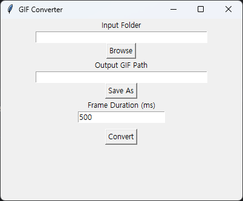

## 📘 GIF Converter
- 이 코드는 이미지들을 하나의 GIF 애니메이션으로 변환하는 Image Converter Sample Project. 

### 📌 프로젝트 개요
- 목적: 여러 PNG 이미지를 하나의 GIF로 변환
- 사용 라이브러리: glob (파일 탐색), PIL.Image (이미지 처리)
- 클래스: GIFConverter

### 📌 전체 코드
```python
import glob
from PIL import Image

class GIFConverter:
    """
    Image to GIF converter
    """
    def __init__(self, path_in=None, path_out=None, resize=(320, 240)) :
        """
        :param path_in: 원본 여러 이미지 경로 (images/*.png)
        :param path_out: 결과 이미지 경로 (output/filename.gif)
        :param resize:  리사이크 크기((320,240))
        """
        self.path_in = path_in or './images/*.png'
        self.path_out = path_out or './output/filename.gif'
        self.resize = resize

    def convert(self):
        """
        GIF 이미지 변환 수행
        """
        print(self.path_in, self.path_out, self.resize)
        img, *images = [Image.open(f).resize(self.resize) for f in sorted(glob.glob(self.path_in))]
        try:
            img.save(
                fp=self.path_out,
                format='GIF',
                append_images=images,
                save_all=True,
                duration=500,
                loop=0,
            )
        except IOError as e:
            print("Converter Error: ", e)
        except Exception as e:
            print(e)
        print("{} created successfully".format(self.path_out))

if __name__ == '__main__':
    c = GIFConverter('./project/images/*.png', './project/image_out/filename.gif', resize=(320, 240))
    c.convert()
    print(GIFConverter.__doc__)

```

### 📌 주요 기능 설명
#### 🔹 1. __init__ 생성자
```python
def __init__(self, path_in=None, path_out=None, resize=(320, 240))
```

- path_in: 원본 이미지 경로 (예: './images/*.png')
- path_out: 결과 GIF 경로 (예: './output/filename.gif')
- resize: 이미지 크기 조정 (기본값: 320×240)
#### 🔹 2. convert() 메소드
```python
img, *images = [Image.open(f).resize(self.resize) for f in sorted(glob.glob(self.path_in))]
```

- glob.glob(self.path_in): 경로에 맞는 이미지 파일 리스트
- Image.open(f).resize(...): 이미지 열고 리사이즈
- img.save(...): 첫 이미지 기준으로 GIF 저장, 나머지는 append_images로 추가
#### 🔹 3. 예외 처리
```python
except IOError as e:
    print("Converter Error: ", e)
```
- 파일 입출력 오류 및 기타 예외 처리

#### 🔹 실행 예시
```python
if __name__ == '__main__':
    c = GIFConverter('./project/images/*.png', './project/image_out/filename.gif', resize=(320, 240))
    c.convert()
    print(GIFConverter.__doc__)
```

#### 🔹  출력 결과 예시
```
./project/images/*.png ./project/image_out/filename.gif (320, 240)
filename.gif created successfully
Image to GIF converter
```


#### 🔹 실무 활용 포인트

| 기능 요소                  | 설명                                                                 |
|----------------------------|----------------------------------------------------------------------|
| `glob`                     | 와일드카드 경로로 이미지 자동 탐색 가능 → 대량 이미지 처리에 유용             |
| 이미지 리사이즈 처리         | 다양한 해상도 이미지를 통일된 크기로 변환 가능 → 일관된 GIF 품질 확보            |
| `save_all=True`            | 여러 프레임을 하나의 GIF로 저장 → 애니메이션 생성에 필수                      |
| `duration`, `loop` 설정     | 프레임 간 시간 간격 및 반복 횟수 제어 가능 → 사용자 경험 최적화 가능             |
| 예외 처리 (`IOError`, `Exception`) | 경로 오류, 파일 누락 등 발생 시 안정적인 메시지 출력 → 유지보수 및 디버깅에 유리     |


---

### 📌 GUI 추가

- GUI 추가 (Tkinter 기반)
- 이미지 포맷 자동 감지
- 프레임 간 시간 조절 기능

#### 🔹 전체 구조 요약
```python
import glob
import os
from PIL import Image
import tkinter as tk
from tkinter import filedialog, messagebox

class GIFConverter:
    def __init__(self, path_in=None, path_out=None, resize=(320, 240), duration=500):
        self.path_in = path_in or './images'
        self.path_out = path_out or './output/filename.gif'
        self.resize = resize
        self.duration = duration

    def convert(self):
        # 이미지 포맷 자동 감지
        image_files = sorted(glob.glob(os.path.join(self.path_in, '*')))
        image_files = [f for f in image_files if f.lower().endswith(('png', 'jpg', 'jpeg', 'bmp'))]

        if not image_files:
            print("No valid image files found.")
            return

        print(f'Converting: {image_files}')
        img, *images = [Image.open(f).resize(self.resize) for f in image_files]

        try:
            img.save(
                fp=self.path_out,
                format='GIF',
                append_images=images,
                save_all=True,
                duration=self.duration,
                loop=0,
            )
            print(f'{self.path_out} created successfully')
        except Exception as e:
            print("Conversion Error:", e)
```
#### 🔹 GUI 추가
```python
class ConverterGUI:
    def __init__(self):
        self.root = tk.Tk()
        self.root.title("GIF Converter")
        self.root.geometry("400x300")

        self.path_in = tk.StringVar()
        self.path_out = tk.StringVar()
        self.duration = tk.IntVar(value=500)

        tk.Label(self.root, text="Input Folder").pack()
        tk.Entry(self.root, textvariable=self.path_in, width=40).pack()
        tk.Button(self.root, text="Browse", command=self.browse_input).pack()

        tk.Label(self.root, text="Output GIF Path").pack()
        tk.Entry(self.root, textvariable=self.path_out, width=40).pack()
        tk.Button(self.root, text="Save As", command=self.browse_output).pack()

        tk.Label(self.root, text="Frame Duration (ms)").pack()
        tk.Entry(self.root, textvariable=self.duration).pack()

        tk.Button(self.root, text="Convert", command=self.run_converter).pack(pady=10)

        self.root.mainloop()

    def browse_input(self):
        folder = filedialog.askdirectory()
        if folder:
            self.path_in.set(folder)

    def browse_output(self):
        file = filedialog.asksaveasfilename(defaultextension=".gif", filetypes=[("GIF files", "*.gif")])
        if file:
            self.path_out.set(file)

    def run_converter(self):
        converter = GIFConverter(
            path_in=self.path_in.get(),
            path_out=self.path_out.get(),
            duration=self.duration.get()
        )
        converter.convert()
        messagebox.showinfo("Done", "GIF created successfully!")

if __name__ == '__main__':
    ConverterGUI()

```




#### 🔹 기능 확장 요약

| 기능 요소         | 설명                                                                 |
|------------------|----------------------------------------------------------------------|
| `glob`           | 다양한 이미지 포맷 자동 탐색 (png, jpg, bmp 등) → 대량 이미지 처리에 유용         |
| `duration`       | 프레임 간 시간 간격 설정 → GIF 애니메이션 속도 조절 가능                         |
| GUI (Tkinter)    | 폴더 선택, 저장 경로 지정, 시간 입력 등 사용자 친화적 인터페이스 제공              |
| 포맷 자동 감지     | 확장자 필터링으로 이미지 포맷 자동 인식 → 사용자가 별도 지정하지 않아도 처리 가능     |
| 예외 처리         | 경로 오류, 파일 누락 등 발생 시 안정적인 메시지 출력 → 유지보수 및 사용자 경험 향상     |

---


