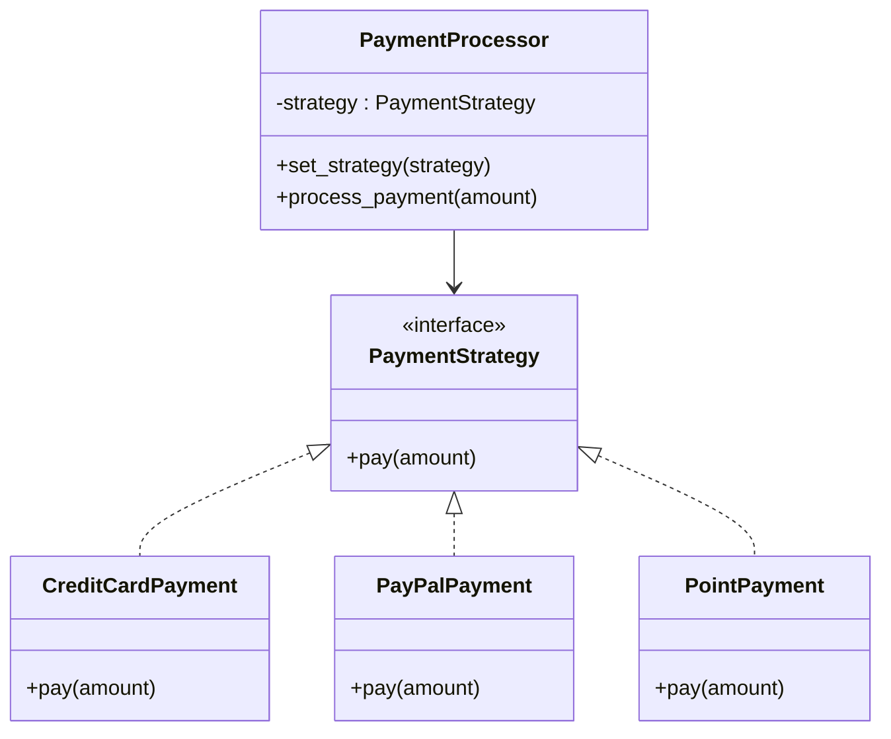

## 📘 전략 패턴(Strategy Pattern)이란?

- 전략 패턴은 알고리즘(전략)을 인터페이스로 정의하고, 이를 동적으로 교체할 수 있도록 설계하는 패턴입니다.  
- 즉, 실행 중에 객체의 행동(전략)을 바꿀 수 있게 해주는 패턴.

### 📌 클래스 다이아그램



### 📌 언제 쓰나?
- 알고리즘(로직)이 여러 개 존재하고, 상황에 따라 바꿔 써야 할 때
- 조건문(if/elif/else)으로 분기되는 복잡한 코드를 객체로 분리하고 싶을 때
- 런타임에 전략을 바꾸고 싶을 때

### 📌 실전 예제: 결제 시스템
#### 🔹 시나리오
- 결제 방식이 여러 가지 있음: 신용카드, 페이팔, 포인트
- 사용자가 원하는 방식으로 결제 전략을 선택할 수 있어야 함

#### 🔹 1. 전략 인터페이스 정의
```python
from abc import ABC, abstractmethod

class PaymentStrategy(ABC):
    @abstractmethod
    def pay(self, amount):
        pass
```


#### 🔹 2. 구체적인 전략 클래스들
```python
class CreditCardPayment(PaymentStrategy):
    def pay(self, amount):
        print(f"[💳] 신용카드로 {amount}원 결제합니다.")

class PayPalPayment(PaymentStrategy):
    def pay(self, amount):
        print(f"[📧] PayPal로 {amount}원 결제합니다.")

class PointPayment(PaymentStrategy):
    def pay(self, amount):
        print(f"[🎁] 포인트로 {amount}원 결제합니다.")
```


#### 🔹 3. Context 클래스 (전략을 사용하는 쪽)
```python
class PaymentProcessor:
    def __init__(self, strategy: PaymentStrategy):
        self.strategy = strategy

    def set_strategy(self, strategy: PaymentStrategy):
        self.strategy = strategy

    def process_payment(self, amount):
        self.strategy.pay(amount)

```

#### 🔹 4. 사용 예시
```python
# 전략 객체 생성
credit = CreditCardPayment()
paypal = PayPalPayment()
point = PointPayment()

# Context에 전략 주입
processor = PaymentProcessor(credit)
processor.process_payment(10000)  # 💳 신용카드 결제

processor.set_strategy(paypal)
processor.process_payment(20000)  # 📧 PayPal 결제

processor.set_strategy(point)
processor.process_payment(5000)   # 🎁 포인트 결제
```


### 📌 전략 패턴 요약

| 구성 요소                                | 설명 |
|-----------------------------------------|------|
| `PaymentStrategy`                        | 전략 인터페이스. 모든 결제 전략이 구현해야 할 `pay()` 메서드 정의 |
| `CreditCardPayment`, `PayPalPayment`, `PointPayment` | 전략 구현 클래스. 각기 다른 결제 방식의 로직을 정의 |
| `PaymentProcessor`                       | 전략을 사용하는 컨텍스트 클래스. 전략 객체를 받아서 실행함 |
| `set_strategy()`                         | 런타임에 전략을 변경할 수 있는 메서드 |

---

