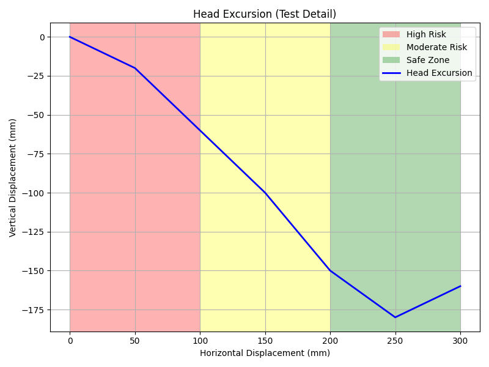
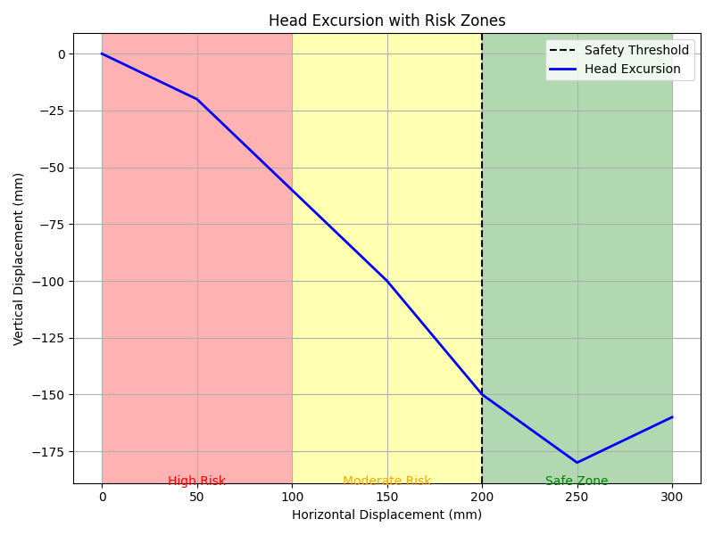

## 📘 axvspan 익히기

### 📌 목표: axvspan 구성 요소
- 배경 색 영역: x축 기준으로 red/yellow/green 영역 나누기
- 데이터 라인: head excursion trajectory (x, y 좌표)
- 축 방향: x축은 수평 이동, y축은 수직 이동

```python
# axvspan (예시 데이터)
x = [0, 50, 100, 150, 200, 250, 300]
y = [0, -20, -60, -100, -150, -180, -160]

fig, ax = plt.subplots(figsize=(8, 6))

# 배경 색 영역 (x축 기준)
ax.axvspan(0, 100, facecolor='red', alpha=0.3, label='High Risk')
ax.axvspan(100, 200, facecolor='yellow', alpha=0.3, label='Moderate Risk')
ax.axvspan(200, 300, facecolor='green', alpha=0.3, label='Safe Zone')

# Head Excursion 라인
ax.plot(x, y, color='blue', linewidth=2, label='Head Excursion')

# 축 설정
ax.set_xlabel('Horizontal Displacement (mm)')
ax.set_ylabel('Vertical Displacement (mm)')
ax.set_title('Head Excursion (Test Detail)')
ax.legend()
ax.grid(True)

plt.tight_layout()
plt.show()
```

- 참조 이미지


### 📌 핵심 함수 설명

| 함수 또는 인자                          | 설명                                                                 |
|----------------------------------------|----------------------------------------------------------------------|
| `ax.axvspan(xmin, xmax, facecolor, alpha)` | x축 방향으로 배경 영역을 색칠할 때 사용 (수직 영역 강조)               |
| `ax.axhspan(ymin, ymax, facecolor, alpha)` | y축 방향으로 배경 영역을 색칠할 때 사용 (수평 영역 강조)               |
| `plot(x, y)`                            | x, y 좌표를 따라 선 그래프를 그리는 기본 함수                         |
| `alpha`                                 | 색상의 투명도 설정 (0.0 = 완전 투명, 1.0 = 불투명)                    |


### 📌 팁
- 색 영역은 기준선이나 안전 한계를 시각적으로 표현할 때 매우 유용.
- ax.axvline()이나 ax.axhline()으로 기준선도 추가할 수 있음.
- ax.text()로 영역에 라벨을 직접 넣는 것도 가능합니다.

---

### 📌 샘플 2
```python
import matplotlib.pyplot as plt

# 예시 데이터: Head Excursion trajectory
x = [0, 50, 100, 150, 200, 250, 300]
y = [0, -20, -60, -100, -150, -180, -160]

fig, ax = plt.subplots(figsize=(8, 6))

# 배경 색 영역 (x축 기준)
ax.axvspan(0, 100, facecolor='red', alpha=0.3)
ax.axvspan(100, 200, facecolor='yellow', alpha=0.3)
ax.axvspan(200, 300, facecolor='green', alpha=0.3)

# 기준선 추가 (예: 안전 한계선)
ax.axvline(x=200, color='black', linestyle='--', linewidth=1.5, label='Safety Threshold')

# 라벨 추가 (영역 이름)
ax.text(50, -190, 'High Risk', color='red', fontsize=10, ha='center')
ax.text(150, -190, 'Moderate Risk', color='orange', fontsize=10, ha='center')
ax.text(250, -190, 'Safe Zone', color='green', fontsize=10, ha='center')

# Head Excursion 궤적
ax.plot(x, y, color='blue', linewidth=2, label='Head Excursion')

# 축 설정
ax.set_xlabel('Horizontal Displacement (mm)')
ax.set_ylabel('Vertical Displacement (mm)')
ax.set_title('Head Excursion with Risk Zones')
ax.legend()
ax.grid(True)

plt.tight_layout()
plt.show()
```

- 참조 이미지


### 📌 핵심 요소 설명

| 함수 또는 기능         | 설명                                                                 |
|------------------------|----------------------------------------------------------------------|
| `ax.axvline()`         | x축 기준으로 수직 기준선을 추가할 때 사용 (예: 안전 한계선 표시)       |
| `ax.text()`            | 그래프 내 특정 위치에 텍스트 라벨을 삽입할 때 사용                      |
| `axvspan()`            | x축 방향으로 배경 색 영역을 설정할 때 사용 (위험 구간 시각화 등)        |
| `plot()`               | x, y 좌표를 따라 선 그래프를 그리는 기본 함수                          |

---


